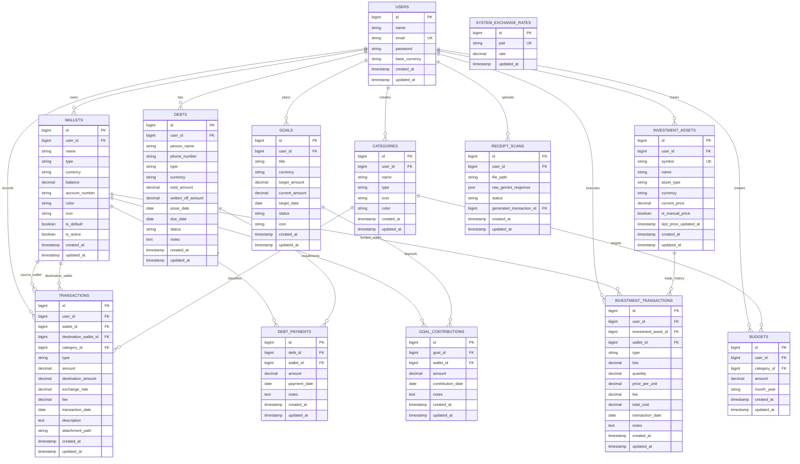

# Entity Relationship Diagram (ERD) & Database Schema
## Tracking Finance: Personal Wealth, Cashflow & Investment Hub

* **Versi Dokumen**: 1.2.0
* **RDBMS**: MySQL 8.0.x (Local WSL: 8.0.46)
* **Framework / ORM**: Laravel 13 (PHP 8.4) / Eloquent
* **Dokumentasi Terkait**:
  - [PRD (Product Requirements)](PRD.md)
  - [Technical Specification & Architecture](TECH_SPEC.md)
  - [Tasks & Backlog Board](TASKS.md)

---

## 1. Visual ERD (Mermaid)

---

## 2. Kamus Data Lengkap (Data Dictionary)

### 2.1 Tabel `users`
| Kolom | Tipe Data | Modifiers | Keterangan |
|---|---|---|---|
| `id` | BIGINT UNSIGNED | PK, Auto Increment | Identifikasi unik pengguna |
| `name` | VARCHAR(255) | Not Null | Nama lengkap pengguna |
| `email` | VARCHAR(255) | Unique, Not Null | Alamat email (untuk login) |
| `password` | VARCHAR(255) | Not Null | Hashed password |
| `base_currency` | VARCHAR(10) | Default: 'IDR' | Mata uang acuan display Net Worth |
| `created_at` / `updated_at` | TIMESTAMP | Nullable | Waktu pembuatan & modifikasi |

---

### 2.2 Tabel `wallets`
| Kolom | Tipe Data | Modifiers | Keterangan |
|---|---|---|---|
| `id` | BIGINT UNSIGNED | PK, Auto Increment | Identifikasi unik dompet |
| `user_id` | BIGINT UNSIGNED | FK ke `users.id`, Cascade | Pemilik dompet |
| `name` | VARCHAR(100) | Not Null | Nama (BCA, Mandiri, Cash, Binance USDT) |
| `type` | ENUM | Not Null | `'bank'`, `'cash'`, `'e_wallet'`, `'investment_cash'` |
| `currency` | VARCHAR(10) | Not Null, Default: 'IDR' | `'IDR'`, `'USD'`, `'USDT'` |
| `balance` | DECIMAL(18,4) | Not Null, Default: 0 | Saldo berjalan dompet |
| `account_number` | VARCHAR(50) | Nullable | Nomor rekening / nomor kartu |
| `color` | VARCHAR(20) | Default: '#3B82F6' | Warna badge di UI Tailwind |
| `icon` | VARCHAR(50) | Default: 'wallet' | Identifier icon (Heroicons/Lucide) |
| `is_default` | BOOLEAN | Default: false | Dompet default otomatis saat catat transaksi |
| `is_active` | BOOLEAN | Default: true | Status aktif dompet |

---

### 2.3 Tabel `categories`
| Kolom | Tipe Data | Modifiers | Keterangan |
|---|---|---|---|
| `id` | BIGINT UNSIGNED | PK, Auto Increment | Identifikasi unik kategori |
| `user_id` | BIGINT UNSIGNED | FK ke `users.id`, Cascade | Pemilik kategori |
| `name` | VARCHAR(100) | Not Null | Makanan, Transport, Gaji, Dividen, dll. |
| `type` | ENUM | Not Null | `'income'`, `'expense'` |
| `icon` | VARCHAR(50) | Default: 'tag' | Icon identifier |
| `color` | VARCHAR(20) | Default: '#10B981' | Warna kategori |

---

### 2.4 Tabel `budgets`
| Kolom | Tipe Data | Modifiers | Keterangan |
|---|---|---|---|
| `id` | BIGINT UNSIGNED | PK, Auto Increment | Identifikasi unik budget |
| `user_id` | BIGINT UNSIGNED | FK ke `users.id`, Cascade | Pemilik budget |
| `category_id` | BIGINT UNSIGNED | FK ke `categories.id`, Cascade | Kategori yang dibatasi |
| `amount` | DECIMAL(15,2) | Not Null | Batas maksimal belanja bulanan |
| `month_year` | VARCHAR(7) | Not Null | Periode budget (Format: `YYYY-MM`) |

---

### 2.5 Tabel `transactions`
| Kolom | Tipe Data | Modifiers | Keterangan |
|---|---|---|---|
| `id` | BIGINT UNSIGNED | PK, Auto Increment | Identifikasi unik transaksi |
| `user_id` | BIGINT UNSIGNED | FK ke `users.id`, Cascade | Pemilik transaksi |
| `wallet_id` | BIGINT UNSIGNED | FK ke `wallets.id`, Cascade | Dompet sumber transaksi |
| `destination_wallet_id` | BIGINT UNSIGNED | FK ke `wallets.id`, Nullable | Dompet tujuan (khusus transfer/exchange) |
| `category_id` | BIGINT UNSIGNED | FK ke `categories.id`, Nullable | Kategori (null untuk transfer) |
| `type` | ENUM | Not Null | `'income'`, `'expense'`, `'transfer'`, `'currency_exchange'` |
| `amount` | DECIMAL(18,4) | Not Null | Nominal keluar dari `wallet_id` |
| `destination_amount` | DECIMAL(18,4) | Nullable | Nominal masuk ke `destination_wallet_id` |
| `exchange_rate` | DECIMAL(18,6) | Nullable | Kurs transaksi (jika antar-currency) |
| `fee` | DECIMAL(15,2) | Default: 0 | Biaya admin transfer |
| `transaction_date` | DATE | Not Null | Tanggal transaksi |
| `description` | TEXT | Nullable | Keterangan / catatan |
| `attachment_path` | VARCHAR(255) | Nullable | URL/path gambar struk |

---

### 2.6 Tabel `debts` & `debt_payments` (Kasus Jamal)
#### Tabel `debts`
| Kolom | Tipe Data | Modifiers | Keterangan |
|---|---|---|---|
| `id` | BIGINT UNSIGNED | PK, Auto Increment | Identifikasi unik utang/piutang |
| `user_id` | BIGINT UNSIGNED | FK ke `users.id`, Cascade | Pemilik catatan |
| `person_name` | VARCHAR(150) | Not Null | Nama peminjam / pemberi pinjaman (Jamal) |
| `phone_number` | VARCHAR(30) | Nullable | Nomor WhatsApp/kontak |
| `type` | ENUM | Not Null | `'receivable'` (piutang kita), `'payable'` (utang kita) |
| `currency` | VARCHAR(10) | Default: 'IDR' | Mata uang pinjaman |
| `total_amount` | DECIMAL(15,2) | Not Null | Total pokok pinjaman |
| `written_off_amount` | DECIMAL(15,2) | Default: 0 | Nominal sisa yang diikhlaskan/diimpaskan |
| `issue_date` | DATE | Not Null | Tanggal uang dipinjamkan |
| `due_date` | DATE | Nullable | Tenggat waktu pengembalian |
| `status` | ENUM | Default: `'unpaid'` | `'unpaid'`, `'partially_paid'`, `'paid'`, `'written_off'` |
| `notes` | TEXT | Nullable | Catatan perjanjian |

#### Tabel `debt_payments`
| Kolom | Tipe Data | Modifiers | Keterangan |
|---|---|---|---|
| `id` | BIGINT UNSIGNED | PK, Auto Increment | Identifikasi unik pembayaran cicilan |
| `debt_id` | BIGINT UNSIGNED | FK ke `debts.id`, Cascade | Utang yang dicicil |
| `wallet_id` | BIGINT UNSIGNED | FK ke `wallets.id`, Restrict | Dompet tempat uang masuk/keluar |
| `amount` | DECIMAL(15,2) | Not Null | Nominal cicilan yang dibayarkan |
| `payment_date` | DATE | Not Null | Tanggal cicilan dibayar |
| `notes` | TEXT | Nullable | Catatan (misal: "Bayar cash di warung") |

---

### 2.7 Tabel `investment_assets` & `investment_transactions`
#### Tabel `investment_assets`
| Kolom | Tipe Data | Modifiers | Keterangan |
|---|---|---|---|
| `id` | BIGINT UNSIGNED | PK, Auto Increment | Identifikasi unik aset |
| `user_id` | BIGINT UNSIGNED | FK ke `users.id`, Cascade | Pemilik aset di portofolio |
| `symbol` | VARCHAR(30) | Not Null | Ticker: `BBCA.JK`, `AAPL`, `BTC` |
| `name` | VARCHAR(150) | Not Null | Nama aset: Bank Central Asia, Bitcoin |
| `asset_type` | ENUM | Not Null | `'idx_stock'`, `'us_stock'`, `'crypto'` |
| `currency` | VARCHAR(10) | Not Null | `'IDR'`, `'USD'`, `'USDT'` |
| `current_price` | DECIMAL(18,6) | Default: 0 | Harga pasar terakhir yang diambil dari API atau manual |
| `is_manual_price` | BOOLEAN | Default: false | Penanda jika harga diisi secara manual sebagai fallback |
| `last_price_updated_at` | TIMESTAMP | Nullable | Waktu terakhir refresh harga pasar |

#### Tabel `investment_transactions`
| Kolom | Tipe Data | Modifiers | Keterangan |
|---|---|---|---|
| `id` | BIGINT UNSIGNED | PK, Auto Increment | Identifikasi unik transaksi investasi |
| `user_id` | BIGINT UNSIGNED | FK ke `users.id`, Cascade | Investor |
| `investment_asset_id` | BIGINT UNSIGNED | FK ke `investment_assets.id` | Aset yang ditransaksikan |
| `wallet_id` | BIGINT UNSIGNED | FK ke `wallets.id`, Nullable | Dompet sumber dana (USDT/USD/IDR) |
| `type` | ENUM | Not Null | `'buy'`, `'sell'`, `'dividend'` |
| `lots` | DECIMAL(10,2) | Nullable | Jumlah lot (khusus saham IDX, 1 lot = 100 lembar) |
| `quantity` | DECIMAL(18,8) | Not Null | Total lembar/koin yang ditransaksikan |
| `price_per_unit` | DECIMAL(18,6) | Not Null | Harga beli/jual per lembar atau per koin |
| `fee` | DECIMAL(15,2) | Default: 0 | Broker fee atau gas fee |
| `total_cost` | DECIMAL(18,4) | Not Null | Total modal: `(quantity * price) + fee` |
| `transaction_date` | DATE | Not Null | Tanggal transaksi |
| `notes` | TEXT | Nullable | Catatan trading |

---

### 2.8 Tabel `goals` & `goal_contributions`
#### Tabel `goals`
| Kolom | Tipe Data | Modifiers | Keterangan |
|---|---|---|---|
| `id` | BIGINT UNSIGNED | PK, Auto Increment | Identifikasi unik goal |
| `user_id` | BIGINT UNSIGNED | FK ke `users.id`, Cascade | Pemilik goal |
| `title` | VARCHAR(150) | Not Null | Misal: Beli Laptop Baru, Dana Darurat |
| `currency` | VARCHAR(10) | Default: 'IDR' | Mata uang target tabungan |
| `target_amount` | DECIMAL(15,2) | Not Null | Nominal target |
| `current_amount` | DECIMAL(15,2) | Default: 0 | Saldo yang sudah terkumpul |
| `target_date` | DATE | Nullable | Tanggal target tercapai |
| `status` | ENUM | Default: `'in_progress'` | `'in_progress'`, `'achieved'`, `'cancelled'` |
| `icon` | VARCHAR(50) | Default: 'flag' | Icon kartu goal |

#### Tabel `goal_contributions`
| Kolom | Tipe Data | Modifiers | Keterangan |
|---|---|---|---|
| `id` | BIGINT UNSIGNED | PK, Auto Increment | Identifikasi unik setoran goal |
| `goal_id` | BIGINT UNSIGNED | FK ke `goals.id`, Cascade | Target tujuan setoran |
| `wallet_id` | BIGINT UNSIGNED | FK ke `wallets.id`, Restrict | Dompet asal uang yang dipindahkan |
| `amount` | DECIMAL(15,2) | Not Null | Nominal yang disisihkan |
| `contribution_date` | DATE | Not Null | Tanggal setoran |
| `notes` | TEXT | Nullable | Catatan setoran |

---

### 2.9 Tabel `receipt_scans` & `system_exchange_rates`
#### Tabel `receipt_scans`
| Kolom | Tipe Data | Modifiers | Keterangan |
|---|---|---|---|
| `id` | BIGINT UNSIGNED | PK, Auto Increment | Identifikasi scan struk |
| `user_id` | BIGINT UNSIGNED | FK ke `users.id`, Cascade | Pengunggah struk |
| `file_path` | VARCHAR(255) | Not Null | Path penyimpanan file foto struk |
| `raw_gemini_response` | JSON | Nullable | Respon JSON mentah dari Gemini Vision API |
| `status` | ENUM | Default: `'pending'` | `'pending'`, `'processed'`, `'failed'` |
| `generated_transaction_id` | BIGINT UNSIGNED | FK ke `transactions.id`, Nullable | Id transaksi yang dibuat setelah diapprove |

#### Tabel `system_exchange_rates`
| Kolom | Tipe Data | Modifiers | Keterangan |
|---|---|---|---|
| `id` | BIGINT UNSIGNED | PK, Auto Increment | Identifikasi kurs |
| `pair` | VARCHAR(20) | Unique, Not Null | `'USD/IDR'`, `'USDT/IDR'` |
| `rate` | DECIMAL(18,6) | Not Null | Kurs acuan konversi Net Worth |
| `updated_at` | TIMESTAMP | Not Null | Waktu terakhir kurs diperbarui |
