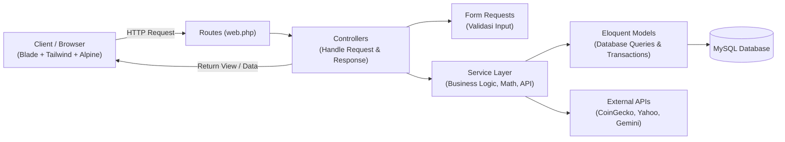

# Technical Specification & Architecture Document (Tech Spec)
## Project: Tracking Finance (Personal Wealth, Cashflow & Investment Hub)

* **Versi Dokumen**: 1.0.0
* **Target Pembaca**: Software Engineers, Technical Leads, & AI Coding Assistants
* **Dokumentasi Terkait**:
  - [PRD (Product Requirements)](PRD.md)
  - [ERD (Database Schema & Dictionary)](ERD.md)
  - [Design System & UI Blueprint](DESIGN.md)
  - [Tasks & Backlog Board](TASKS.md)

---

## 1. System Overview & Technology Stack

Proyek ini dibangun sebagai aplikasi web monolitik modern yang memprioritaskan kesederhanaan, performa cepat, dan kemudahan pemeliharaan (*maintainability*).

| Komponen | Teknologi | Versi Target | Keterangan |
|---|---|---|---|
| **Runtime / Bahasa** | PHP | `8.4.x` (Lokal WSL: 8.4.27) | PHP 8.4 typed properties, asymmetric visibility |
| **Framework Backend** | Laravel | `^13.0` (Latest: 13.x) | Modern skeleton, standard MVC + Service pattern |
| **Database** | MySQL | `8.0.x` (Lokal WSL: 8.0.46) | Relational DB dengan decimal precision |
| **ORM** | Laravel Eloquent | Bawaan | Relasi database, mutator, casting |
| **Authentication** | Laravel Breeze (Blade Stack) | Latest | Session-based auth, secure, ringan |
| **Frontend Template** | Laravel Blade | Bawaan | Server-rendered HTML components |
| **CSS Framework** | Tailwind CSS | `v4.3+` (v4.x) | Menggunakan plugin Vite resmi `@tailwindcss/vite` |
| **Asset Bundler** | Vite | Latest | Hot Module Replacement (HMR) cepat |
| **Client Interactivity** | Alpine.js | `v3.x` | Modals, tabs, dropdowns (tanpa runtime berat) |
| **Visual Charts** | Chart.js | `v4.x` | Grafik donut pengeluaran & grafik garis PnL |

---

## 2. Arsitektur Pola Desain (Design Patterns)

Untuk menjaga kode tetap bersih dan tidak menumpuk di Controller (*Fat Controller anti-pattern*), aplikasi ini menggunakan pola **Controller-Service-Model**:



### 2.1 Service Layer Directory (`app/Services/`)
Semua logika perhitungan matematika, mutasi keuangan, dan panggilan API pihak ketiga **wajib** diletakkan di dalam Service Class:
1. `WalletService.php`:
   - Menangani mutasi saldo dompet secara atomik (`DB::transaction`).
   - Menangani konversi kurs transfer antar mata uang berbeda (`currency_exchange`).
2. `DebtService.php`:
   - Menangani pencatatan cicilan utang/piutang (kasus Jamal).
   - Mengupdate status `unpaid`, `partially_paid`, atau `paid`.
3. `InvestmentService.php`:
   - Menghitung **Average Down (Weighted Average Cost)** saat transaksi beli baru.
   - Menghitung **Unrealized (Floating) PnL** dan persentasenya.
   - Mengkonversi lot saham Indonesia ke lembar ($1\text{ lot} = 100\text{ lembar}$).
4. `MarketPriceService.php`:
   - Mengambil harga crypto real-time via **CoinGecko API**.
   - Mengambil harga saham IDX dan US via **Yahoo Finance API**.
   - Mengupdate tabel `system_exchange_rates` (USD/IDR).
5. `GeminiReceiptService.php`:
   - Mengirim gambar struk ke Google Gemini Vision API (`gemini-1.5-flash` / `gemini-2.5-flash`).
   - Melakukan parsing respon JSON terstruktur (merchant, nominal, kategori, tanggal).

---

## 3. Integrasi API Pihak Ketiga (External API Contracts)

### 3.1 Google Gemini Vision API (Receipt Scanner)
* **Endpoint**: `https://generativelanguage.googleapis.com/v1beta/models/gemini-1.5-flash:generateContent`
* **Metode**: POST (Header `x-goog-api-key: {GEMINI_API_KEY}`)
* **Expected JSON Contract Output**:
  ```json
  {
    "merchant_name": "Indomaret Point",
    "total_amount": 78500,
    "transaction_date": "2026-11-08",
    "suggested_category": "Belanja Bulanan",
    "items": [
      {"name": "Roti Gandum", "price": 22000},
      {"name": "Susu UHT 1L", "price": 28500},
      {"name": "Kopi Botol", "price": 28000}
    ]
  }
  ```

### 3.2 CoinGecko API (Crypto Prices)
* **Endpoint (Free Tier, tanpa Auth)**:
  `https://api.coingecko.com/api/v3/simple/price?ids=bitcoin,ethereum,solana&vs_currencies=usd,idr`
* **Response**:
  ```json
  {
    "bitcoin": {"usd": 92450, "idr": 1465332500},
    "ethereum": {"usd": 3120, "idr": 49452000}
  }
  ```

### 3.3 Yahoo Finance / Ticker Quotes (Saham US & IDX)
* **Konvensi Simbol Ticker**:
  - Saham Indonesia: Akhiran `.JK` (Contoh: `BBCA.JK`, `BBRI.JK`, `TLKM.JK`).
  - Saham US: Ticker standar (Contoh: `AAPL`, `NVDA`, `MSFT`).
  - Kurs USD ke IDR: `USDIDR=X`.

---

## 4. Struktur Folder Standar Kode (Project Structure)

```text
tracking-finance/
├── app/
│   ├── Http/
│   │   ├── Controllers/
│   │   │   ├── DashboardController.php
│   │   │   ├── WalletController.php
│   │   │   ├── TransactionController.php
│   │   │   ├── DebtController.php
│   │   │   ├── InvestmentController.php
│   │   │   ├── GoalController.php
│   │   │   └── ReceiptScannerController.php
│   │   └── Requests/            # Validasi form request
│   │       ├── StoreTransactionRequest.php
│   │       ├── StoreDebtPaymentRequest.php
│   │       └── StoreInvestmentTradeRequest.php
│   ├── Models/                  # Eloquent models (User, Wallet, Transaction, dll.)
│   └── Services/                # Service layer (bisnis & kalkulasi matematika)
│       ├── WalletService.php
│       ├── DebtService.php
│       ├── InvestmentService.php
│       ├── MarketPriceService.php
│       └── GeminiReceiptService.php
├── config/                      # Konfigurasi aplikasi
├── database/
│   ├── migrations/              # 12 migrasi tabel database
│   └── seeders/                 # Default categories (Makanan, Gaji, dll.)
├── docs/                        # Dokumentasi Arsitektur, PRD, ERD, & Design
│   ├── PRD.md
│   ├── ERD.md
│   ├── TECH_SPEC.md
│   ├── DESIGN.md
│   ├── STITCH_PROMPTS.md
│   ├── TASKS.md
│   └── ref_design/
├── resources/
│   ├── css/
│   │   └── app.css              # Entrypoint Tailwind CSS
│   ├── js/
│   │   └── app.js               # Entrypoint Alpine.js & Chart.js
│   └── views/
│       ├── components/          # Reusable Blade UI components (card, modal, badge)
│       ├── layouts/             # Master app layout (sidebar, navbar)
│       ├── dashboard.blade.php
│       ├── wallets/
│       ├── transactions/
│       ├── debts/
│       ├── investments/
│       └── goals/
├── routes/
│   └── web.php                  # Web routes yang dilindungi middleware 'auth'
├── AGENTS.md                    # Universal AI prompt & context directive
└── .env.example                 # Template variabel environment
```

---

## 5. Konfigurasi Lingkungan (`.env` Specification)

Variabel penting yang wajib dikonfigurasi saat pertama kali menjalankan proyek di environment baru:

```env
APP_NAME="Tracking Finance"
APP_ENV=local
APP_KEY=
APP_DEBUG=true
APP_TIMEZONE="Asia/Jakarta"
APP_URL=http://localhost:8000

# Database MySQL
DB_CONNECTION=mysql
DB_HOST=127.0.0.1
DB_PORT=3306
DB_DATABASE=tracking_finance
DB_USERNAME=root
DB_PASSWORD=

# Integrasi API Eksternal
GEMINI_API_KEY=your_gemini_api_key_here
COINGECKO_API_KEY=               # Opsional (free tier tidak butuh key)

# Pengaturan Mata Uang Default
DEFAULT_BASE_CURRENCY=IDR
```

---

## 6. Aturan Khusus untuk AI Assistant Baru (Prompting Directives)

Jika sesi percakapan dipindahkan ke AI lain atau di sesi baru, instruksikan AI tersebut dengan aturan berikut (rujuk selengkapnya di [AGENTS.md](../AGENTS.md)):
1. **Dilarang Mengubah Tech Stack**: Selalu gunakan Laravel 13 (PHP 8.4) + Blade + Tailwind CSS v4.3 + Alpine.js. Jangan beralih ke React, Vue, atau Livewire kecuali diminta secara eksplisit oleh pengguna.
2. **Kepatuhan Terhadap Skema Database**: Selalu rujuk file `docs/ERD.md` untuk nama tabel dan kolom. Jangan mengarang nama kolom baru tanpa update ERD.
3. **Database Transactions**: Semua operasi mutasi saldo (dompet, transfer, cicilan utang, pembelian aset) **wajib dibungkus** dengan `DB::transaction()` untuk mencegah inkonsistensi data saldo.
4. **Pedagogical Coding Style**: Pengguna adalah pemula yang sedang belajar. Setiap kali membuat atau memodifikasi file, jelaskan secara singkat alur kerjanya (*apa fungsi baris kode ini*).
5. **Tailwind CSS Utility**: Gunakan styling class Tailwind murni di file `.blade.php`. Hindari menulis CSS kustom di file CSS eksternal kecuali utility animasi sederhana.
6. **Git Commit Standards (Conventional Commits v1.2.0)**: Selalu gunakan format `<type>(<scope>): <subject>` dengan imperative mood (`feat`, `fix`, `docs`, `refactor`, `style`, `test`, `build`, `chore`). Dilarang membuat commit besar yang menggabungkan banyak perubahan yang tidak berhubungan (gunakan atomic commit).
7. **Scope Guardrails (Anti Out-Of-Topic)**: Jangan menambahkan fitur atau library yang tidak tercantum di `docs/PRD.md` tanpa persetujuan pengguna.
8. **Update Task Board**: Setiap kali suatu tiket selesai dikerjakan, perbarui checklist `[x]` dan tanggal selesai di `docs/TASKS.md` **sebelum** melakukan commit, lalu gabungkan ke dalam 1 commit tunggal dengan pesan Conventional Commits yang mewakili tugas tersebut (tanpa mencantumkan ID tiket di pesan commit).

---

## 7. Developer Cheatsheet (Quick Commands)

Perintah yang digunakan untuk setup dan menjalankan aplikasi:

```bash
# 1. Install dependencies
composer install
npm install

# 2. Setup environment & key
cp .env.example .env
php artisan key:generate

# 3. Jalankan migrasi database & data seeder
php artisan migrate --seed

# 4. Jalankan development server
php artisan serve              # Server Laravel di http://localhost:8000
npm run dev                    # Vite bundler & hot-reload Tailwind
```
